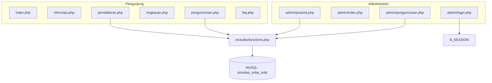

# Website Simulasi Pendaftaran dan Pengumuman SNBP/SNBT 2026

Simulasi seleksi nasional dengan web sederhana. Siswa mengisi formulir pendaftaran, server memeriksa isiannya, nomor peserta terbit otomatis, lalu peserta mencetak kartu tanda. Guru atau panitia mencatat kelulusan lewat panel administrator, dan setiap orang bisa memeriksa hasilnya dengan nomor peserta atau NISN.

---

### Apa yang ada di repositori ini

Aplikasi web satu direktori, tanpa framework dan tanpa proses build. PHP merender halaman, PDO mengirim kueri berparameter ke MySQL, dan seluruh aset visual diambil dari image ikut disertakan. Folder [css/](css/), [js/](js/), [fonts/](fonts/), dan [images/](images/) dibuat tanpa menggunakan pustaka UI tambahan.

Proyek ini dibuat untuk satu alur utuh: dari seorang siswa mengisi formulir, sampai statusnya berubah menjadi Lulus di panel admin, lalu tampil lagi di halaman pengumuman yang bisa diakses publik.

Kalau Anda baru meng-clone repositori ini, bagian yang paling Anda butuhkan ada di [Menjalankan proyek](#menjalankan-proyek). Sisanya bisa dibaca belakangan.

---

### Menjalankan proyek

Aplikasi butuh PHP 8.0 atau lebih baru, dan MySQL yang bisa diakses lewat phpMyAdmin. Ada dua cara menjalankan, pilih yang paling sesuai dengan alat yang sudah Anda punya.

#### Menjalankan lewat XAMPP atau Laragon

1. Salin folder proyek ke web root server lokal Anda:

   - XAMPP: `C:\xampp\htdocs\tugas-pweb-week9`
   - Laragon: `C:\laragon\www\tugas-pweb-week9`

2. Buka control panel XAMPP atau Laragon, lalu nyalakan layanan Apache dan MySQL.
3. Buka phpMyAdmin di [http://localhost/phpmyadmin](http://localhost/phpmyadmin), buat database bernama `simulasi_snbp_snbt`, lalu import [database.sql](database.sql) lewat menu Import.
4. Buka portal di [http://localhost/tugas-pweb-week9/index.php](http://localhost/tugas-pweb-week9/index.php).

#### Menjalankan lewat PHP built-in server

Cocok kalau Anda tidak ingin memasang XAMPP atau Laragon. Server bawaan PHP sudah cukup untuk kebutuhan praktikum.

1. Buka terminal di dalam folder proyek.
2. Jalankan server bawaan:

   ```bash
   php -S 127.0.0.1:8000
   ```

3. Buka [http://127.0.0.1:8000/index.php](http://127.0.0.1:8000/index.php) di browser.

Server bawaan PHP hanya untuk pengembangan. Jangan dipakai untuk melayani trafik nyata.

#### Memeriksa hasil pemasangan

Buka halaman beranda. Kalau MySQL belum aktif atau databasenya belum di-import, halaman tersebut menampilkan pesan error beserta langkah perbaikannya, jadi Anda tidak perlu menebak-nebak penyebabnya.

---

### Arsitektur

Halaman publik dan administrator membaca dan menulis ke satu basis data MySQL. Semua akses basis data melewati fungsi di [includes/functions.php](includes/functions.php), dan kuerinya selalu memakai prepared statement PDO, sehingga input pengguna tidak pernah dirangkai langsung ke dalam SQL.



Berkas template dan aset dipisah dari logika. [includes/header.php](includes/header.php) dan [includes/footer.php](includes/footer.php) dipakai oleh halaman publik, sedangkan [admin/header.php](admin/header.php) dan [admin/footer.php](admin/footer.php) dipakai panel administrator. [admin/header.php](admin/header.php) juga menjadi satu-satunya penjaga halaman admin: setiap halaman yang memakainya otomatis menolak selain yang sudah login.

---

### Yang bisa dilakukan aplikasi

| Halaman | Yang dikerjakan | Berkas |
|---|---|---|
| Beranda | Slider hero, ringkasan jalur seleksi, dan tautan cepat ke pengecekan hasil | [index.php](index.php) |
| Informasi seleksi | Penjelasan jalur SNBP dan SNBT, daftar program studi beserta kuota dan akreditasi, syarat pendaftaran, jadwal tahapan | [informasi.php](informasi.php) |
| Formulir pendaftaran | Mengisi nama, NISN, asal sekolah, email, jalur seleksi, pilihan prodi satu dan dua, lalu menyetujui pernyataan simulasi | [pendaftaran.php](pendaftaran.php) |
| Validasi pendaftaran | Memeriksa isian di server: nama minimal tiga karakter, NISN tepat sepuluh digit angka, format email, pilihan prodi satu dan dua tidak boleh sama, dan pernyataan wajib dicentang | [includes/functions.php](includes/functions.php) |
| Nomor peserta | Menyusun nomor peserta unik berawalan jalur seleksi, misalnya `SNBP-2026-317`, otomatis saat pendaftaran berhasil | [includes/functions.php](includes/functions.php) |
| Kartu tanda peserta | Menampilkan kartu tanda versi simulasi lengkap dengan tombol cetak ukuran A4 | [ringkasan.php](ringkasan.php) |
| Pengecekan hasil | Mencari peserta dengan nomor peserta atau NISN, lalu menampilkan status Lulus, Tidak Lulus, atau Menunggu beserta prodi yang diterima, pesan panitia, dan tombol cetak SKHS | [pengumuman.php](pengumuman.php) |
| Bantuan | Pertanyaan umum dan petunjuk teknis pendaftaran | [faq.php](faq.php) |
| Login administrator | Autentikasi berbasis sesi PHP dengan pesan kesalahan yang jelas saat kredensial salah | [admin/login.php](admin/login.php) |
| Dasbor administrator | Kartu statistik pendaftar, pendaftar terbaru, dan tautan ke modul pengelolaan | [admin/index.php](admin/index.php) |
| Kelola peserta | Menambah, melihat, mengubah, dan menghapus data pendaftar, dengan pencarian, filter jalur seleksi, dan ekspor CSV | [admin/peserta.php](admin/peserta.php) |
| Tetapkan kelulusan | Mengubah status hasil peserta, mengisi prodi yang diterima, dan menulis pesan hasil yang tampil di halaman pengumuman | [admin/pengumuman.php](admin/pengumuman.php) |
| Keluar administrator | Menghapus sesi login dan mengembalikan admin ke halaman masuk | [admin/logout.php](admin/logout.php) |

---

### Data demo dan akun uji

Berkas [database.sql](database.sql) sudah berisi data awal, jadi tidak perlu membuat data secara manual. Isinya mencakup daftar program studi, jadwal tahapan seleksi, dan peserta contoh berikut:

| Nomor peserta | Jalur | Status | Prodi diterima |
|---|---|---|---|
| SNBP-2026-001 | SNBP | Lulus | Teknik Informatika |
| SNBT-2026-002 | SNBT | Tidak Lulus | |
| SNBP-2026-003 | SNBP | Menunggu | |
| SNBT-2026-004 | SNBT | Lulus | Ilmu Komunikasi |

Peserta dengan status Lulus dipakai untuk mencoba tampilan kartu tanda, peserta Tidak Lulus untuk memeriksa jalur penolakan, dan peserta Menunggu untuk memastikan pencarian belum menghasilkan keputusan.

Panel administrator memakai akun bawaan berikut:

| Kolom | Nilai |
|---|---|
| Halaman | [admin/login.php](admin/login.php) |
| Username | `admin` |
| Password | `admin123` |

Akun ini untuk keperluan demo di kelas. Ganti sebelum aplikasi dipakai di lingkungan lain.

---

### Konfigurasi

Semua parameter koneksi ada di satu berkas, [config/database.php](config/database.php):

| Variabel | Nilai bawaan | Catatan |
|---|---|---|
| `$host` | `127.0.0.1` | Alamat server MySQL |
| `$dbname` | `simulasi_snbp_snbt` | Nama database hasil import [database.sql](database.sql) |
| `$username` | `root` | Pengguna MySQL |
| `$password` | *(kosong)* | Isi dengan password MySQL Anda |

Untuk dipasang di hosting, unggah isi folder proyek ke web root, buat database MySQL, import [database.sql](database.sql) lewat phpMyAdmin, lalu sesuaikan keempat variabel di atas. Ganti `root` dan password kosongnya, karena bawaan proyek ini hanya cocok untuk server lokal yang tidak terekspos ke jaringan.

---

### Struktur repositori

```text
tugas-pweb-week9/
├── admin/                # Panel administrator
│   ├── footer.php        # Footer template panel admin
│   ├── header.php        # Header dan penjaga sesi admin
│   ├── index.php         # Dasbor: statistik dan pendaftar terbaru
│   ├── login.php         # Form masuk administrator
│   ├── logout.php        # Hapus sesi dan kembali ke halaman masuk
│   ├── pengumuman.php    # Tetapkan status kelulusan peserta
│   └── peserta.php       # Kelola data pendaftar, ekspor CSV
├── config/
│   └── database.php      # Koneksi PDO ke MySQL
├── includes/
│   ├── footer.php        # Footer template Cologne Education
│   ├── functions.php     # Logika bisnis, validasi, kueri, sesi
│   └── header.php        # Header template Cologne Education
├── css/                  # Stylesheet template Cologne Education
├── fonts/                # Webfont dan ikon template
├── images/               # Gambar dan aset slider template
├── js/                   # Pustaka JavaScript template
├── database.sql          # Skema MySQL dan data awal
├── index.php             # Beranda portal
├── informasi.php         # Informasi seleksi, program studi, jadwal
├── pendaftaran.php       # Formulir pendaftaran
├── ringkasan.php         # Kartu tanda peserta
├── pengumuman.php        # Pengecekan hasil kelulusan
├── faq.php               # Bantuan dan FAQ
└── README.md             # Dokumen yang sedang Anda baca
```

---

### Batasan yang perlu diketahui

Fitur di atas adalah hasil akhir satu tugas praktikum, bukan aplikasi produksi. Beberapa hal berikut akan terasa saat Anda menerapkannya atau menjadikannya dasar proyek lain.

- Autentikasi administrator memakai sesi PHP tanpa token CSRF, dan halaman admin dijaga oleh pemeriksaan sesi di [admin/header.php](admin/header.php).
- Login menerima password dalam bentuk teks biasa sebagai cadangan, selain hash bcrypt, supaya akun bawaan tetap bisa dipakai. Hapus jalur cadangan itu sebelum dipakai di server publik.
- Daftar peserta di [admin/peserta.php](admin/peserta.php) memuat seluruh baris tanpa paginasi, jadi tampilannya melambat ketika data bertambah banyak.
- Tidak ada pengiriman email. Pesan hasil hanya tampil di portal dan harus dibaca peserta secara langsung.
- Data pendaftar disimpan apa adanya di MySQL, termasuk NISN dan asal sekolah. Jangan memasukkan data pribadi asli.
- Halaman publik tidak memakai pagination maupun cache, padahal halaman beranda mengambil statistik langsung dari database setiap kali diakses.
- Nomor peserta pendaftar baru disusun dari tiga angka acak setelah tahun dan jalur seleksi, jadi tiap jalur hanya punya 900 kombinasi. Bayangan bentrok pada kolom unik baru muncul setelah banyak peserta mendaftar.

---

### Dokumentasi

| Dokumen | Isi |
|---|---|
| [README.md](README.md) | Dokumen ini: cara menjalankan, konfigurasi, dan peta fitur |
| [database.sql](database.sql) | Skema MySQL beserta data awal, ini rujukan resmi bentuk tabel dan nilai bawaan |

Repositori ini belum memuat dokumen lain seperti CONTRIBUTING.md, CHANGELOG.md, atau LICENSE. Kalau proyek ini dikembangkan bersama, dokumen-dokumen itu sebaiknya ditambahkan agar tidak bergantung pada ingatan satu orang.

---

